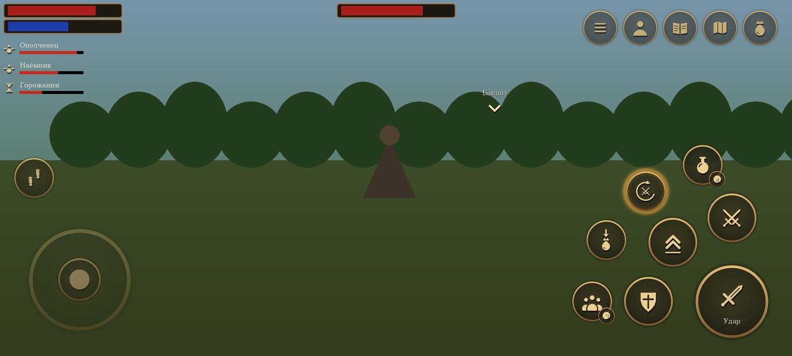
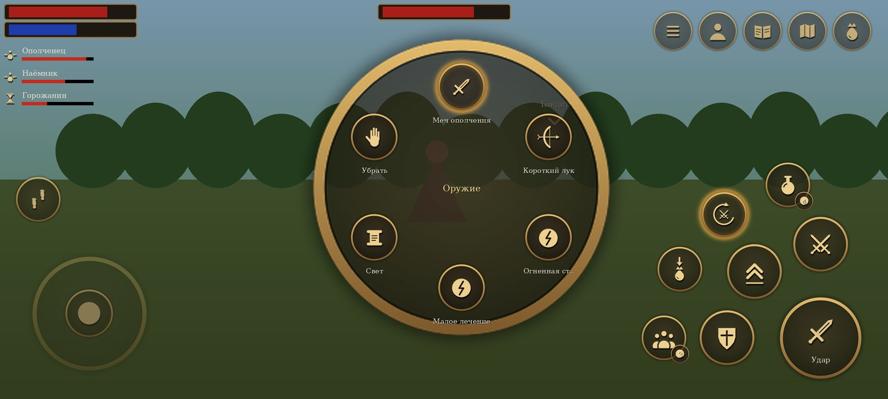
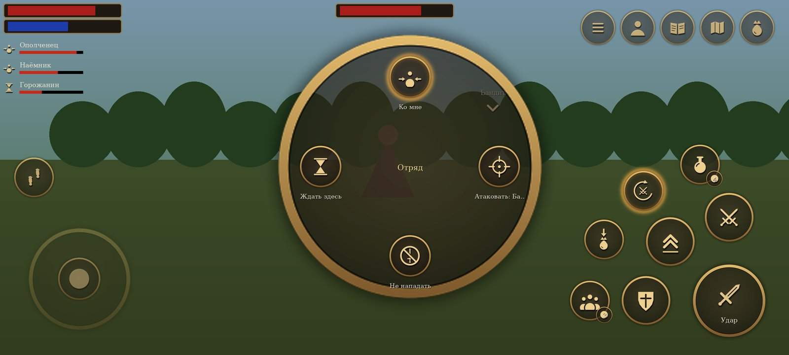

# Сенсорное управление

Как устроено управление на телефоне и почему именно так. Код — `common/ui/touchinput.*` (раскладка,
жесты, колёса), `common/ui/touchicons.*` (рисованные значки), `PlayerControl` (бой, цель, «Собрать»),
`common/game/companions.cpp` (отряд) в патче движка.

*Макет 2400×1080 (телефон игрока): те же формулы раскладки и те же значки, что в игре; фон условный.*

## Принципы

1. **Внизу экрана лежат большие пальцы.** Поэтому полоски здоровья, маны и дыхания стоят столбиком
   **слева вверху** (в оригинале — в нижних углах, под пальцами их не видно в бою). Полоска врага, имя
   цели и сообщения игры остаются сверху по центру. В диалоге, сумке и документе полосок нет — там
   свои окна игры.
2. **Главное — под правым большим пальцем, по дугам.** Главная кнопка в углу, вокруг неё на одном
   расстоянии — «Оружие», «Прыжок», «Блок», дальше — вторая дуга. Пальцу не нужно искать кнопку:
   все на одинаковом вылете от угла, между кнопками не меньше 15 dp, зона касания больше рисунка на 8 dp.
3. **Кнопка появляется, когда нужна.** «Блок» — только с оружием ближнего боя в руках, «Зелье» — если
   есть зелья (на кнопке — сколько), «Собрать» — если рядом есть что взять, «Отряд» — если есть
   напарники (на кнопке — сколько). В мирной прогулке на экране 5–6 кнопок справа.
4. **Одна кнопка — одно место.** Кнопки не переезжают между режимами; меняется только значок и подпись
   главной кнопки.
5. **Касание мимо кнопок ничего не ломает.** В мире оно — джойстик или обзор, на экранах со списками —
   выбор ячейки/реплики или ничего (случайный тап не применит предмет и не выберет ответ).
6. **Стиль игры.** Тёмная кожа, кольцо старой бронзы, значки старым золотом с тенью; всё рисуется со
   сглаживанием под размер экрана (поле расстояний), без текстур в APK. Подписи — шрифтом игры.

## Мир

| Где | Что | Как |
|---|---|---|
| Левая половина | **Джойстик** (появляется под пальцем) | чуть сдвинуть — шаг, до края — бег (с запасом, чтобы не дёргалось); вбок без оружия — поворот, с оружием — шаг в сторону; палец ушёл далеко — центр едет следом |
| Правая половина | **Обзор** | вести пальцем; **коснуться NPC — выбрать цель** (золотая стрелка над головой), коснуться пустого места — снять выбор |
| Угол справа внизу | **Главная кнопка** | что сделает — написано на ней (см. ниже) |
| Над главной | **Оружие** | коснуться — достать последнее оружие/убрать; подержать или потянуть — **колесо оружия и заклинаний** |
| Слева-сверху от главной | **Прыжок** | — |
| Слева от главной | **Блок** | держать (только с оружием ближнего боя) |
| Вторая дуга | **Зелье** | коснуться — лечение (сначала слабые), подержать — мана; на кнопке — число зелий лечения |
| | **Автобой** | вкл/выкл (светится, когда включён) |
| | **Собрать** | герой сам обходит и подбирает всё бесхозное рядом; ещё раз — стоп |
| | **Отряд** | колесо приказов напарникам |
| Слева посередине | **Красться** | вкл/выкл (нужно умение) |
| Справа вверху | **Сумка, Карта, Журнал, Герой, Меню** | «Меню» подержать — быстрое сохранение (кольцо заполняется) |
| Слева вверху | Полоски героя и **отряд** | имя, здоровье и приказ каждого напарника |

### Главная кнопка

| В руках | Цель | Кнопка | Действие |
|---|---|---|---|
| ничего | живой NPC | «Говорить» | разговор |
| | лежащий NPC | «Обыскать» | обыск |
| | предмет | «Взять» | подобрать |
| | сундук / предмет мира | «Открыть» / «Использовать» | как в игре |
| кулаки, меч | — | «Удар» | держать — серия ударов точно в окна комбо; свайп влево/вправо — боковой удар |
| | оглушённый | «Добить» | новым нажатием (удержание никого не добивает) |
| лук, арбалет | — | «Выстрел» / «Нет стрел» | держать — целиться и стрелять; свайп влево/вправо — соседняя цель |
| руна, свиток | — | название заклинания | держать — накопить и сотворить; свайп — соседняя цель |

**Выбранная касанием цель** — для боя: с оружием в руках фокус держится на ней (в пределах дальности
оружия), герой доворачивается к ней при ударе, лук и магия бьют в неё. Для разговора и подбора работает
обычный фокус игры. Цель снимается, если умерла, исчезла или дальше 40 м.

### Колесо оружия

Меч (или кулаки), лук/арбалет, руны и свитки из ячеек 3–0 сумки, «Убрать». Выбор: потянуть «Оружие» в
сторону нужного пункта и отпустить; или подержать «Оружие» — колесо останется открытым, коснуться
пункта. В центре — полное название. Колесо стоит левее кнопок и не закрывает их.

### Отряд

| Приказ | Что делают напарники |
|---|---|
| **Ко мне** | идут следом; если дрались — бросают бой и бегут к герою |
| **Атаковать: <цель>** | нападают на выбранную касанием цель (или ту, на которую смотрит герой) |
| **Не нападать** | сами не начинают драк (ни врагов вокруг, ни чужих стычек); начатый бой бросают; если ударят их — защищаются |
| **Защищать** | (по умолчанию) дерутся с врагами, **вступаются за героя и друг друга** и нападают на любого, кого ударил герой |
| **Ждать здесь** | стоят у ближайшей точки пути и заняты своими делами (см. «Привал»); вступаются только за тех, кто рядом с ними |

**Почему раньше стояли, когда на героя нападали люди.** В скриптах Gothic II напарник (`ZS_Follow_Player`)
нападает сам только на врагов по гильдии (`B_AssessEnemy`), а в драку людей (`B_AssessFightSound`)
вмешиваются стражники и друзья — нанятый безымянный NPC герою не «друг», поэтому смотрел. Теперь раз в
0,4 с каждый напарник ищет **врага отряда** в 20 м от героя и нападает сам — через `B_Attack` скриптов
игры, как это делают стражники: с репликой, своим оружием и концом боя по правилам. Враг отряда:
- бьёт героя или напарника (`ZS_Attack`/`ZS_MM_Attack` с целью из отряда);
- монстр угрожает герою или напарнику перед броском (`ZS_MM_ThreatenEnemy`);
- **его ударил герой** — кто угодно, хоть мирный горожанин (`squadNoteHit` из `Npc::takeDamage`): 30 с
  после последнего удара он враг отряда;
- **он ударил героя или напарника**, даже если не в бою (стрелок, маг) — тоже 30 с.

Зверей — насмерть; врагов по гильдии — насмерть; остальных людей — **только сбивает с ног**
(`AR_GuardStopsFight`): сюжетные NPC не погибнут от руки напарника, добить может только герой. Когда
герой дерётся с мирным, напарник не смотрит (`ZS_WatchFight`) и не вступается за жертву — он бьёт её.

**Не вмешиваются** в арену (`AIV_ArenaFight`) и в поединки, начатые из диалога (`AR_NONE`): там победу
засчитывают скрипты, только если победил сам герой (`AIV_DefeatedByPlayer`, дуэли наёмников Онара).
Приказ «Атаковать» — осознанный выбор игрока, он действует и там.

Приказ хранится в свободной ячейке `aivar[95]` NPC (скрипты используют 0–80 и 88) — переживает
сохранение и загрузку; новый напарник получает приказ отряда.

**До шести напарников.** Панель слева вверху ужимает строки, а если и так не влезает над «Красться» —
ставит второй столбец.

### Напарник в отряде

- **Не погибает.** Удар, который убил бы его, только валит без сознания (как людей в драке, `ZS_Unconscious`);
  добить его нельзя ни врагу, ни герою. Оружие из рук он **не роняет** (встаёт с ним же). Через 20 с он
  встаёт, **пьёт зелья** и идёт дальше. В воде без сознания утонул бы — там он просто держится на последнем
  здоровье.
- **Не обижается на героя.** Кражу (в том числе своих вещей), удар героя или другого напарника, вход в чужой
  дом, оружие в руках героя, убийство, шум, тревогу стражи напарник не замечает (перцепции
  `ASSESSTHEFT`, `ASSESSDAMAGE`, `ASSESSENTERROOM`… от героя и отряда), а напасть на героя или на своего,
  выгонять его из дома или следить за ним не станет. Если «преступление» всё же запомнилось (по старому
  сохранению), оно забывается вместе с его вкладом в счётчик города (`B_DeletePetzCrime`) — лорду Андре он
  не пожалуется и разговор не обрывает (`DIA_Ambient_NEWS`); обида («зол», «враждебен») прощается.
  Когда герой дерётся с врагом, напарник помогает; когда с кем-то мирным — не вступается ни за кого.
- **Не обирает побеждённых.** В конце боя победитель-человек по скриптам обыскивает упавшего: забирает
  золото и подбирает его оружие (`ZS_RansackBody`). Напарник этого не делает; лежащего напарника тоже
  никто не обирает.
- **Зелья всегда есть.** Лечится напарник сам, как NPC игры (`ZS_HealSelf`: пьёт ItPo_Health_03…01, пока
  не вылечится) — после того как пришёл в себя и после боя, если здоровья меньше половины. Перед этим ему
  докладывается ровно столько зелий, сколько не хватает (свои он пьёт первыми). Запас появляется в момент
  нужды — вынести бесконечные зелья через обмен нельзя.
- **«Покажи, что у тебя есть»** в разговоре — окно обмена, как торговля, но даром: «Взять» — его вещь,
  «Отдать» — свою (стопкой). Деньги не переходят ни в одну сторону; надетое на нём не показывается. Закрыл
  окно — напарник надевает и берёт в руки лучшее из того, что у него есть (доспех, оружие, лук).

### В пути

Скрипт игры ведёт напарника к герою по прямой (`AI_GotoNpc` в `ZS_Follow_Player`), без поиска пути: за
парой поворотов он упирался в стену, вдали от героя движок его почти не обрабатывает — он «пропадал», а у
героя все сбегались в одну точку и толкались. Теперь дорогу выбирает отряд (`tickSquadFollow`):

- **Строй.** У каждого своё место веером позади героя — по направлению, куда герой идёт (а не куда
  смотрит: повернулся на месте — строй не бегает вокруг): два — в 2,7 м под 30°, два — в 3 м по бокам,
  два — в 4,4 м сзади; между соседями не меньше 1,8 м. Места не видно от героя (стена, дерево, узкий
  проход) — место на следе героя, **цепочкой**: первый в 2,5 м, следующие через 1,5 м. Герой идёт —
  напарники идут с упреждением, шагом или бегом по обстановке; стоит — стоят на своих местах лицом к нему.
- **Дорога.** Место видно — прямо к нему. Не видно (за углом) — **по следу героя**: точки, где герой
  прошёл последние ~90 м (там точно можно пройти), к самой свежей видимой. Следа не видно — по сети точек
  пути игры к точке у героя (`AI_GoToPoint` ищет путь).
- **Телепорт.** Отстал дальше 35 м, 8 с не видит героя дальше 12 м или 6 с стоит на месте, хотя герой
  дальше 6 м (застрял), — переносится на след героя за его спиной (3–8 м по следу: там земля, и камера туда
  не смотрит). Пока герой в воздухе, плывёт или сидит на скамье — не переносит.
- В бою, в разговоре, без сознания, когда лечится или занят делом на привале — своим ходом не ведётся.

### Привал

Ждущий напарник и отряд рядом с героем, который **25 с стоит на месте** (оружие убрано, никто ни с кем не
дерётся), заняты случайными делами — анимациями бездействия из распорядков игры. Дела выбираются по долям
вероятности, одно и то же дважды подряд не бывает, отряд начинает вразнобой:

| Дело | Доля | Как |
|---|---|---|
| Руки на груди | 7 | чешется, потягивается, переминается |
| Руки за спиной | 5 | иногда оглядывается |
| Осматривается | 4 | смотрит по сторонам, чешет затылок |
| Курит | 7 | косяк, затяжка раз в 4–8 с |
| Ест | 7 | яблоко, сыр, бекон, хлеб или баранина; в конце вытирает рот |
| Подкидывает яблоко | 5 | и иногда откусывает |
| Пьёт | 6 | шнапс или вино; иногда смотрит на бутылку, вытирает рот |
| Играет на лютне | 3 | |
| Упражняется с оружием | 6 | только с одноручным |
| Рассматривает оружие | 4 | |
| Упражняется в магии | 6 | только послушники и маги |
| Сидит | 8 | ждущий — у костра, если он в 12 м, иначе на земле |
| Отходит пописать | 4 | к точке в 4–10 м, спиной к герою; ждущий потом возвращается на место |
| Молится | 1 (паладины и маги — 5) | на коленях |
| Танцует | 1 | |
| Беседует | 16 | если рядом другой свободный напарник: по очереди реплики `$SMALLTALK` своими голосами |

Предмет для дела (косяк, еда, лютня), если своего нет, создаётся и потом убирается. Пока идёт дело, цикл
распорядка молчит — им управляет отряд; любая перемена прерывает его: нападение и разговор (их состояния
сами всё убирают), герой пошёл, достал оружие, новый приказ — напарник встаёт тем же движением, что в
скриптах, убирает предмет и оружие и догоняет героя. Далеко от героя (вне ближней обработки) дел нет.

### «Собрать»

Кнопка видна, если в **20 м** есть **бесхозные** вещи (без владельца и гильдии-владельца) или **мёртвые** с
добычей, и на героя не нападают. Герой убирает оружие, идёт к ближайшему, подбирает (как вручную — с
анимацией и проверкой кражи скриптами), у тела берёт всё, что дал бы обыск, и идёт к следующему. Чужое
не трогает — взять чужое можно только вручную, осознанно (это кража). **Всё выпавшее оружие и щиты** —
у убитых, у сбитых с ног — ничьи и помечены выпавшими (`ITEM_DROPPED`), как в оригинальной игре: подобрать
их не кража ни вручную, ни «Собрать». (Раньше OpenGothic записывал выпавшее оружие собственностью
уронившего, а пометку не ставил — поэтому подобранный меч напарника считался кражей.) Оружие, выпавшее до
этой версии, собирается, если его хозяина нет в живых. Мечи, которые лежат у кого-то дома как его вещь, —
по-прежнему чужие. Оглушённых не обыскивает. Не
дойти (стена, обрыв) за 5 с + 1 с на каждые 2 м пути — пропускает. Перепад высоты — с запасом на склон.
Палец на джойстике или кнопке боя, нападение, диалог — сбор прекращается. В конце — «Собрано: N».

**Почему герой иногда вставал у тела и не обыскивал.** К телу его ведёт `AI_GoToNpc`, а он останавливает на
дистанции удара кулаком (`FightAlgo::prefferedAttackDistance`: у тела человека 1,7 м, крысы 2,8 м). Сбор же
ждал подхода на 1,6 м, причём по прямой между центрами (центр стоящего героя на ~0,8 м выше лежащего
тела) — так и стоял до таймаута, а тело пропускал. Теперь расстояние по горизонтали и с той же дистанцией,
на которой игра останавливает героя.

## Диалог

- **Коснуться реплики** — выделить, **коснуться выделенной** — выбрать (две касания — защита от случайного
  ответа). Или стрелки слева и «Выбрать» справа внизу.
- «Пропуск» (слева внизу, пока говорят) — пропустить фразу.

## Сумка, сундук, тело, торговля

- **Коснуться ячейки** — выделить, **коснуться выделенной** — применить/надеть (сумка), взять одну
  (сундук, тело), купить/продать одну (торговля). Сетку другой стороны выбирает касание по ней.
- **Палец вверх-вниз по сетке** — листать.
- Кнопка справа внизу называет действие: «Применить», «Взять» (вся стопка), «Положить» (вся стопка),
  «Купить», «Продать» (по одной — деньги).
- «Взять всё» — над сеткой сундука/тела, рядом с его названием. «Закрыть» — слева внизу.

## Взлом замка

Большие стрелки «влево»/«вправо» слева внизу и «Отойти» — для сундуков и дверей.

## Ролики и сцены

«Пропустить» справа вверху.

## Что проверить на телефоне

Порядок — в docs/TEST_PLAN.md. Особенно: удобно ли тянуться ко второй дуге, хватает ли зазоров,
читаются ли значки на светлом небе, не мешает ли выбор цели касанием обзору, как напарники ведут себя
в драках с людьми, на привале и без сознания, «Собрать» после боя с волками и бандитами.
