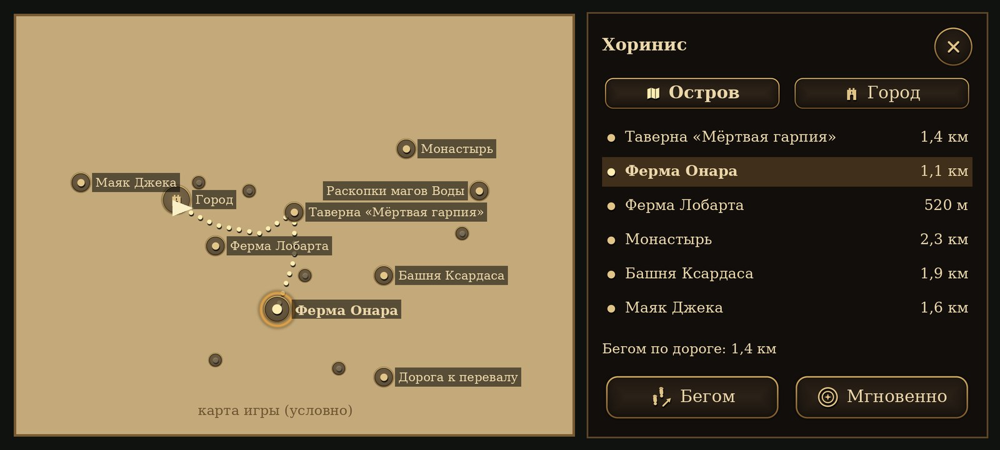
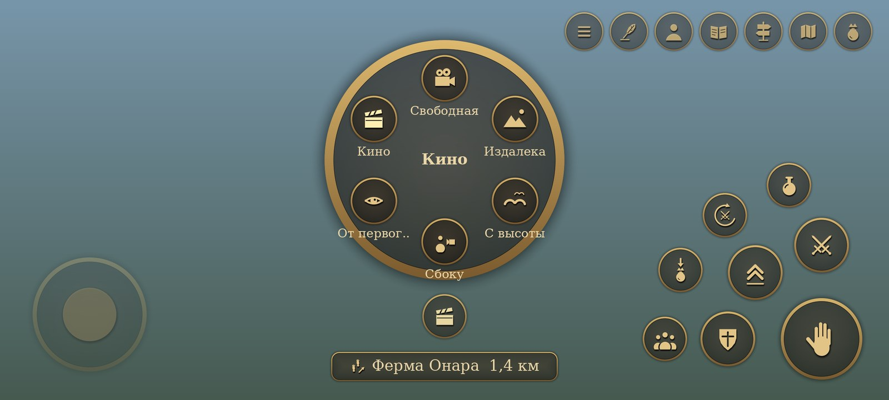

# Сенсорное управление

Как устроено управление на телефоне и почему именно так. Код — `common/ui/touchinput.*` (раскладка,
жесты, колёса, карта «Путь»), `common/ui/touchicons.*` (рисованные значки), `PlayerControl` (бой, цель,
«Собрать», «Путь»), `common/game/companions.cpp` (отряд), `common/game/travelpoints.*` (места «Пути») в патче
движка.

*Макет 2400×1080 (телефон игрока): те же формулы раскладки и те же значки, что в игре; фон условный.*

## Принципы

1. **Внизу экрана лежат большие пальцы.** Поэтому полоски здоровья, маны и дыхания стоят столбиком
   **слева вверху** (в оригинале — в нижних углах, под пальцами их не видно в бою). Полоска врага, имя
   цели и сообщения игры остаются сверху по центру. В диалоге, сумке и документе полосок нет — там
   свои окна игры.
2. **Главное — под правым большим пальцем, по дугам.** Главная кнопка в углу, вокруг неё на одном
   расстоянии — «Оружие», «Прыжок», «Блок», дальше — вторая дуга. Пальцу не нужно искать кнопку:
   все на одинаковом вылете от угла, между кнопками не меньше 15 dp, зона касания больше рисунка на 8 dp.
3. **Кнопка появляется, когда нужна.** «Блок» — только с оружием ближнего боя в руках, «Зелье» — если
   есть зелья (на кнопке — сколько), «Собрать» — если рядом есть что взять, «Отряд» — если есть
   напарники (на кнопке — сколько), «Сказать» — если рядом человек, к которому можно обратиться. В мирной прогулке на экране
   5–6 кнопок справа.
4. **Одна кнопка — одно место.** Кнопки не переезжают между режимами; меняется только значок и подпись
   главной кнопки.
5. **Касание мимо кнопок ничего не ломает.** В мире оно — джойстик или обзор, на экранах со списками —
   выбор ячейки/реплики или ничего (случайный тап не применит предмет и не выберет ответ).
6. **Стиль игры.** Тёмная кожа, кольцо старой бронзы, значки старым золотом с тенью; всё рисуется со
   сглаживанием под размер экрана (поле расстояний), без текстур в APK. Подписи — шрифтом игры.

## Мир

| Где | Что | Как |
|---|---|---|
| Левая половина | **Джойстик** (появляется под пальцем) | чуть сдвинуть — шаг, до края — бег (с запасом, чтобы не дёргалось); вбок без оружия — поворот, с оружием — шаг в сторону; палец ушёл далеко — центр едет следом |
| Правая половина | **Обзор** | вести пальцем; **коснуться NPC — выбрать цель** (золотая стрелка над головой), коснуться пустого места — снять выбор |
| Угол справа внизу | **Главная кнопка** | что сделает — написано на ней (см. ниже) |
| Над главной | **Оружие** | коснуться — достать последнее оружие/убрать; подержать или потянуть — **колесо оружия и заклинаний** |
| Слева-сверху от главной | **Прыжок** | — |
| Слева от главной | **Блок** | держать (только с оружием ближнего боя) |
| Вторая дуга | **Зелье** | коснуться — лечение (сначала слабые), подержать — мана; на кнопке — число зелий лечения |
| | **Автобой** | вкл/выкл (светится, когда включён) |
| | **Собрать** | герой сам обходит и подбирает всё бесхозное рядом; ещё раз — стоп |
| | **Отряд** | колесо приказов напарникам |
| Над «Оружием», у края | **Сказать** (микрофон) | кому — подписано над кнопкой: выбранному касанием, иначе тому, на кого смотрит герой (любой человек в сознании до 12 м — «живой житель»), иначе Геральту рядом (docs/AI_NPC.md). Голосом или текстом без диалога — как выбрано в настройках, в панели можно переключиться («Написать» / «Голосом») |
| Слева посередине | **Красться** | вкл/выкл (нужно умение) |
| Справа вверху | **Сумка, Карта, Путь, Журнал, Герой, Сохранить, Меню** | «Путь» — быстрое перемещение (см. ниже); «Сохранить» — быстрое сохранение, подержать — быстрая загрузка (кольцо заполняется) |
| Слева вверху | Полоски героя и **отряд** | имя, здоровье и приказ каждого напарника |

### Главная кнопка

| В руках | Цель | Кнопка | Действие |
|---|---|---|---|
| ничего | живой NPC | «Говорить» | разговор |
| | лежащий NPC | «Обыскать» | обыск |
| | предмет | «Взять» | подобрать |
| | сундук / предмет мира | «Открыть» / «Использовать» | как в игре |
| кулаки, меч | — | «Удар» | держать — серия ударов точно в окна комбо; свайп влево/вправо — боковой удар |
| | оглушённый | «Добить» | новым нажатием (удержание никого не добивает) |
| лук, арбалет | — | «Выстрел» / «Нет стрел» | держать — целиться и стрелять; свайп влево/вправо — соседняя цель |
| руна, свиток | — | название заклинания | держать — накопить и сотворить; свайп — соседняя цель |

**Выбранная касанием цель** — для боя: с оружием в руках фокус держится на ней (в пределах дальности
оружия), герой доворачивается к ней при ударе, лук и магия бьют в неё. Для разговора и подбора работает
обычный фокус игры. Цель снимается, если умерла, исчезла или дальше 40 м.

### Колесо оружия

Меч (или кулаки), лук/арбалет, руны и свитки из ячеек 3–0 сумки, «Убрать». Выбор: потянуть «Оружие» в
сторону нужного пункта и отпустить; или подержать «Оружие» — колесо останется открытым, коснуться
пункта. В центре — полное название. Колесо стоит левее кнопок и не закрывает их.

### Отряд

| Приказ | Что делают напарники |
|---|---|
| **Ко мне** | идут следом; если дрались — бросают бой и бегут к герою |
| **Атаковать: <цель>** | нападают на выбранную касанием цель (или ту, на которую смотрит герой) |
| **Не нападать** | сами не начинают драк (ни врагов вокруг, ни чужих стычек); начатый бой бросают; если ударят их — защищаются |
| **Защищать** | (по умолчанию) дерутся с врагами, **вступаются за героя и друг друга** и нападают на любого, кого ударил герой |
| **Ждать здесь** | лагерь там, где стоят (см. «Лагерь»): сидят, беседуют, курят…; вступаются только за тех, кто рядом с ними |

**Почему раньше стояли, когда на героя нападали люди.** В скриптах Gothic II напарник (`ZS_Follow_Player`)
нападает сам только на врагов по гильдии (`B_AssessEnemy`), а в драку людей (`B_AssessFightSound`)
вмешиваются стражники и друзья — нанятый безымянный NPC герою не «друг», поэтому смотрел. Теперь раз в
0,4 с каждый напарник ищет **врага отряда** в 20 м от героя и нападает сам — через `B_Attack` скриптов
игры, как это делают стражники: с репликой, своим оружием и концом боя по правилам. Враг отряда:
- бьёт героя или напарника (`ZS_Attack`/`ZS_MM_Attack` с целью из отряда);
- монстр угрожает герою или напарнику перед броском (`ZS_MM_ThreatenEnemy`);
- **его ударил герой** — кто угодно, хоть мирный горожанин (`squadNoteHit` из `Npc::takeDamage`): 30 с
  после последнего удара он враг отряда;
- **он ударил героя или напарника**, даже если не в бою (стрелок, маг) — тоже 30 с.

Зверей — насмерть; врагов по гильдии — насмерть; остальных людей — **только сбивает с ног**
(`AR_GuardStopsFight`): сюжетные NPC не погибнут от руки напарника, добить может только герой. Когда
герой дерётся с мирным, напарник не смотрит (`ZS_WatchFight`) и не вступается за жертву — он бьёт её.

**Не вмешиваются** в арену (`AIV_ArenaFight`) и в поединки, начатые из диалога (`AR_NONE`): там победу
засчитывают скрипты, только если победил сам герой (`AIV_DefeatedByPlayer`, дуэли наёмников Онара).
Приказ «Атаковать» — осознанный выбор игрока, он действует и там.

Приказ хранится в свободной ячейке `aivar[95]` NPC (скрипты используют 0–80 и 88) — переживает
сохранение и загрузку; новый напарник получает приказ отряда.

**До шести напарников.** Панель слева вверху ужимает строки, а если и так не влезает над «Красться» —
ставит второй столбец.

### Напарник в отряде

- **Не погибает.** Удар, который убил бы его, только валит без сознания (как людей в драке, `ZS_Unconscious`);
  добить его нельзя ни врагу, ни герою. Оружие из рук он **не роняет** (встаёт с ним же). Через 20 с он
  встаёт, **пьёт зелья** и идёт дальше. В воде без сознания утонул бы — там он просто держится на последнем
  здоровье.
- **Не обижается на героя.** Кражу (в том числе своих вещей), удар героя или другого напарника, вход в чужой
  дом, оружие в руках героя, убийство, шум, тревогу стражи напарник не замечает (перцепции
  `ASSESSTHEFT`, `ASSESSDAMAGE`, `ASSESSENTERROOM`… от героя и отряда), а напасть на героя или на своего,
  выгонять его из дома или следить за ним не станет. Если «преступление» всё же запомнилось (по старому
  сохранению), оно забывается вместе с его вкладом в счётчик города (`B_DeletePetzCrime`) — лорду Андре он
  не пожалуется и разговор не обрывает (`DIA_Ambient_NEWS`); обида («зол», «враждебен») прощается.
  Когда герой дерётся с врагом, напарник помогает; когда с кем-то мирным — не вступается ни за кого.
- **Не обирает побеждённых.** В конце боя победитель-человек по скриптам обыскивает упавшего: забирает
  золото и подбирает его оружие (`ZS_RansackBody`). Напарник этого не делает; лежащего напарника тоже
  никто не обирает.
- **Зелья всегда есть.** Лечится напарник сам, как NPC игры (`ZS_HealSelf`: пьёт ItPo_Health_03…01, пока
  не вылечится) — после того как пришёл в себя и после боя, если здоровья меньше половины. Перед этим ему
  докладывается ровно столько зелий, сколько не хватает (свои он пьёт первыми). Запас появляется в момент
  нужды — вынести бесконечные зелья через обмен нельзя.
- **«Покажи, что у тебя есть»** в разговоре — окно обмена, как торговля, но даром: «Взять» — его вещь,
  «Отдать» — свою (стопкой). Деньги не переходят ни в одну сторону; надетое на нём не показывается. Закрыл
  окно — напарник надевает и берёт в руки лучшее из того, что у него есть (доспех, оружие, лук).

### В пути

Скрипт игры ведёт напарника к герою по прямой (`AI_GotoNpc` в `ZS_Follow_Player`), без поиска пути: за
парой поворотов он упирался в стену, вдали от героя движок его почти не обрабатывает — он «пропадал», а у
героя все сбегались в одну точку и толкались. Теперь дорогу выбирает отряд (`tickSquadFollow`):

- **Строй.** У каждого своё место тесной группой позади героя — по направлению, куда герой идёт (а не куда
  смотрит: повернулся на месте — строй не бегает вокруг): двое в 1,4 м за спиной, трое в 2,4 м, один в
  3,4 м; центры соседей в 1,1 м — между плечами около полуметра, как идут люди. Места не видно от героя
  (стена, дерево, узкий проход) — место на следе героя, **цепочкой** через 1,1 м. Герой идёт — напарники
  идут с упреждением, шагом или бегом по обстановке; стоит — стоят на своих местах (точнее 0,5 м) лицом к нему.
- **Дорога.** Место видно — прямо к нему. Не видно (за углом) — **по следу героя**: точки, где герой
  прошёл последние ~90 м (там точно можно пройти), к самой свежей видимой. Следа не видно — по сети точек
  пути игры к точке у героя (`AI_GoToPoint` ищет путь).
- **Телепорт.** Отстал дальше 35 м, 8 с не видит героя дальше 12 м или 6 с стоит на месте, хотя герой
  дальше 6 м (застрял), — переносится на след героя за его спиной (3–8 м по следу: там земля, и камера туда
  не смотрит). Пока герой в воздухе, плывёт или сидит на скамье — не переносит.
- В бою, в разговоре, без сознания, когда лечится или занят делом на привале — своим ходом не ведётся.

### Лагерь («Ждать здесь»)

Каждый остаётся **там, где стоял**, и никуда не уходит. Раньше распорядок вёл всех к ближайшей точке пути
игры (и к свободным точкам «STAND») — отряд сходился в одну точку. Теперь распорядок — `ZS_Stand_ArmsCrossed`
с точкой-меткой `G2M_CAMP` (такой точки нет, скрипт никуда не ведёт), а цикл распорядка в лагере молчит
(`Npc::isCompanionCamp`); перцепции работают — враги, разговор с героем как обычно. По приказу каждый
поворачивается к ближайшему товарищу. Перевод времени (сон) напарников не уносит к точкам распорядка
(`Npc::resetPositionToTA`): ждущий остаётся в лагере, идущий за героем — рядом с ним.

### Привал

В лагере и рядом с героем, который **25 с стоит на месте** (оружие убрано, никто ни с кем не дерётся),
напарники заняты случайными делами — анимациями бездействия из распорядков игры. Дела выбираются по долям
вероятности, одно и то же дважды подряд не бывает, отряд начинает вразнобой. Танцев и молитв нет.

| Дело | Лагерь | У героя | Как |
|---|---|---|---|
| Сидит | 14 | 8 | на земле на своём месте; в лагере — у костра, если он в 8 м; 40–90 с. Рядом сидит товарищ — перекидываются словом |
| Скамья, стул | 12 | 6 | если свободная в 8 м (у героя — в 5 м): идёт и садится (`AI_UseMob`), потом возвращается на место; сидя — тоже болтают |
| Беседует | 18 | 14 | стоя, с другим свободным напарником рядом: по очереди реплики `$SMALLTALK` своими голосами |
| Курит | 7 | 7 | косяк, затяжка раз в 4–8 с |
| Ест | 6 | 6 | яблоко, сыр, бекон, хлеб или баранина; в конце вытирает рот |
| Пьёт | 6 | 5 | шнапс или вино; иногда смотрит на бутылку, вытирает рот |
| Руки на груди | 5 | 7 | чешется, потягивается, переминается |
| Подкидывает яблоко | 4 | 5 | и иногда откусывает |
| Играет на лютне | 4 | 3 | |
| Упражняется в магии | 4 | 5 | только послушники и маги |
| Руки за спиной | 3 | 5 | иногда оглядывается |
| Осматривается | 3 | 4 | смотрит по сторонам, чешет затылок |
| Упражняется с оружием | 3 | 4 | только с одноручным и если никого нет в 2 м |
| Рассматривает оружие | 3 | 4 | если никого нет в 2 м |
| Отходит пописать | — | 3 | к точке в 4–10 м, спиной к герою |

Предмет для дела (косяк, еда, лютня), если своего нет, создаётся и потом убирается. Пока идёт дело, цикл
распорядка молчит — им управляет отряд; любая перемена прерывает его: нападение и разговор (их состояния
сами всё убирают), герой пошёл, достал оружие, новый приказ — напарник встаёт тем же движением, что в
скриптах (со скамьи — `AI_UseMob(-1)`), убирает предмет и оружие и догоняет героя. Далеко от героя (вне
ближней обработки) дел нет.

### «Собрать»

Кнопка видна, если в **20 м** есть **бесхозные** вещи (без владельца и гильдии-владельца) или **мёртвые** с
добычей, и на героя не нападают. Герой убирает оружие, идёт к ближайшему, подбирает (как вручную — с
анимацией и проверкой кражи скриптами), у тела берёт всё, что дал бы обыск, и идёт к следующему. Чужое
не трогает — взять чужое можно только вручную, осознанно (это кража). **Не только то, что видно из глаз**:
за деревом, кустом, забором — если видно чуть сбоку или сверху, или рядом (в 8 м) есть точка сети путей
игры, откуда видно. **Дорога**: видно напрямик — прямо; нет — через ту точку сети путей (`AI_GoToPoint` ищет
путь в обход стен и деревьев), потом к вещи. Упёрся по дороге на 2,5 с — в обход по сети путей; и там
застрял — пропускает. **Всё выпавшее оружие и щиты** —
у убитых, у сбитых с ног — ничьи и помечены выпавшими (`ITEM_DROPPED`), как в оригинальной игре: подобрать
их не кража ни вручную, ни «Собрать». (Раньше OpenGothic записывал выпавшее оружие собственностью
уронившего, а пометку не ставил — поэтому подобранный меч напарника считался кражей.) Оружие, выпавшее до
этой версии, собирается, если его хозяина нет в живых. Мечи, которые лежат у кого-то дома как его вещь, —
по-прежнему чужие. Оглушённых не обыскивает. Не
дойти за 7 с + 0,6 с на каждый метр — пропускает. Перепад высоты — с запасом на склон.
Палец на джойстике или кнопке боя, нападение, диалог — сбор прекращается. В конце — «Собрано: N».

**Почему герой иногда вставал у тела и не обыскивал.** К телу его ведёт `AI_GoToNpc`, а он останавливает на
дистанции удара кулаком (`FightAlgo::prefferedAttackDistance`: у тела человека 1,7 м, крысы 2,8 м). Сбор же
ждал подхода на 1,6 м, причём по прямой между центрами (центр стоящего героя на ~0,8 м выше лежащего
тела) — так и стоял до таймаута, а тело пропускал. Теперь расстояние по горизонтали и с той же дистанцией,
на которой игра останавливает героя.

### Быстрое сохранение

Кнопка **«Сохранить»** (перо) в верхнем ряду, рядом с «Меню».

- **Коснуться** — быстрое сохранение в ячейку быстрого сохранения игры (`save_slot_0.sav`, в меню загрузки — первая
  строка), как F5 на компьютере. Когда запись кончится — «Игра сохранена» (или «Не удалось сохранить игру»). Имя
  ячейки — «Быстрое сохранение».
- **Нельзя**, и кнопка говорит почему: **во время боя** (кто-то нападает на героя в 15 м — случайное касание не
  должно записать сохранение за миг до гибели), в прыжке и падении, без сознания, в разговоре, сумке, ролике,
  во время мгновенного перемещения, пока идёт прошлое сохранение.
- **Подержать** (кольцо заполняется, 0,7 с) — **быстрая загрузка**: окно «Загрузить быстрое сохранение?» с
  игровым днём и временем и когда оно записано; «Загрузить» / «Отмена» (и кнопка «Назад» телефона). Пока окно
  открыто, игра на паузе. Нет сохранения — «Быстрого сохранения нет».
- **Запись не портит прежнее сохранение**: любое сохранение (и из меню) пишется во временный файл и заменяет
  ячейку одним шагом — сбой или нехватка места посреди записи оставляют старое сохранение целым.
- Перед записью герой бросает ход по очереди ИИ («Путь» бегом, «Собрать»): иначе после загрузки он шёл бы сам
  и не слушался джойстика. Путь бегом после сохранения продолжается сам.
- Раньше быстрое сохранение было на удержании «Меню» — теперь «Меню» только открывает меню.

### «Путь» — быстрое перемещение

*Макет 2400×1080: те же формулы раскладки и значки, что в игре; карта и места на ней условные — в игре это
карта из файлов игры (та же текстура и координаты, что у карты-предмета), места — где они есть в мире.*

Кнопка **«Путь»** (дорожный указатель) рядом с «Картой» открывает **карту текущего мира** с местами, куда можно
отправиться. Карта — из игры (`Map_NewWorld.tga`, `Map_NewWorld_City.tga`, `Map_OldWorld.tga`, `Map_AddonWorld.tga`
с теми же координатами `Doc_SetLevelCoords`, что у карт-предметов в скриптах), её не нужно покупать. Пока карта
открыта, **игра на паузе**.

- **Хоринис** — две вкладки: «Остров» и «Город» (на карте острова город — одна метка-башня, коснуться — карта
  города). Открыто там, где герой: в городе — карта города.
- **Места**: главные — крупные метки с подписью, второстепенные — мелкие (подпись — когда выбрано). Справа —
  список всех мест этой карты с расстоянием по прямой; листать пальцем. Золотая стрелка — герой (как на карте
  игры).
- **Выбрать** — касанием по метке или строке списка: на карте золотыми точками рисуется **путь бегом** — тот же
  поиск по сети путей игры, что поведёт героя, — и его длина. Дороги нет — «только мгновенно».
- **Галочки для пути бегом** — **«Сражаться»** и **«Собирать лут»**, обе включены. Снять «Сражаться» — герой не
  останавливается драться, бежит дальше (напарники дерутся сами); здоровья меньше четверти — остановится выпить
  зелье, а без зелий путь прерывается. Снять «Собирать лут» — бежит мимо добычи («Собрать» вручную работает и в
  пути). Галочки помнятся до выхода из игры.
- **«Бегом»** или **«Мгновенно»** — отправиться. Куда шли в прошлый раз, при открытии уже выбрано: продолжить
  прерванный путь — «Путь» → «Бегом».
- Только места текущего мира: в Долину Рудников и Яркендар ведут проходы самой игры (перевал, портал).
- Закрыть — крестик или кнопка «Назад» телефона.

**Мгновенно.** Экран темнеет (0,45 с), герой переносится на место (как телепорт рун игры: место, поворот, камера
за спиной), напарники, которые идут следом, встают рядом с ним в строю (ждущие остаются в лагере), — экран
светлеет, «Ты на месте: …». Нельзя, если на героя нападают, в воде, в прыжке, на скамье, в разговоре. Время в
игре не идёт.

**Бегом** — герой бежит сам, как будто играет за тебя, а ты смотришь:

- **Дорога** — по сети путей игры (`AI_GoToPoint`: тот же поиск пути, по которому ходят NPC — по дорогам, в
  обход стен, по лестницам). Внизу посередине строка: куда, сколько осталось, что сейчас («бой», «сбор добычи»,
  «разговор»). Кнопка «Путь» на это время — «стоп».
- **Бой** (если стоит «Сражаться»). Напали (на героя или напарника, в 15 м) или враждебный зверь, орк в 9 м и его видно — герой
  останавливается, достаёт оружие ближнего боя и дерётся **автобоем** (тот же боевой ИИ игры, даже если кнопка
  «Автобой» выключена), пьёт зелья при малом здоровье. Не одолеть за 45 с (на скале, над водой) — бросает его
  и бежит дальше. Врагов нет 1,2 с — бой кончен.
- **Добыча** (если стоит «Собирать лут»). После боя — «Собрать» в 20 м (тела побеждённых, их оружие), по пути — всё бесхозное в 12 м от
  дороги (травы, вещи на земле, мёртвые). Чужое не трогает (это кража — только вручную). Что не удалось взять,
  больше не манит с дороги. Убрать оружие — и дальше.
- **Лечение.** Перед тем как бежать дальше: здоровья меньше 40 % — зелье (сначала слабые). Зелий нет, а
  здоровья меньше четверти, — путь прерывается: решай сам.
- **Разговор.** Кто-то заговорил по дороге — герой останавливается; кончился разговор — бежит дальше. **Страж
  прохода** (ворота города, верхний квартал, ворота перевала, замок) — путь прерывается: пропустил он или нет,
  дальше решаешь ты. Останавливают трижды за минуту на одном месте — путь прерывается.
- **Не враги.** Напал стражник или горожанин (не враг по гильдии: украл, ударил) — герой с ним **не дерётся**,
  путь прерывается.
- **Застрял** (4 с на месте): путь заново с того места, где он сейчас → через следующую точку пути → шаг к ней
  переносом, только если её видно (не сквозь стену и не за запертые ворота) → «Дальше не пройти — путь
  прерван». У самого места (в 20 м) — «на месте».
- **Прервать**: джойстик, «Удар», «Блок», «Прыжок», «Оружие», кнопка «Путь» (стоп), без сознания. Сумка во
  время пути — путь ждёт. «Собрать» — сначала сбор, потом дальше.
- Отряд идёт следом своим ходом (строй, след героя, перенос отставших — см. «В пути»).

#### Камера в пути

Пока герой бежит сам, камера его не ведёт и на него не влияет: **палец справа крутит камеру вокруг героя**
(вбок — облёт, вверх-вниз — выше или ниже), а герой бежит своей дорогой — смотри куда хочешь. Курс камеры
следует за тем, куда герой бежит, плавно: на поворотах дороги кадр не дёргается. Разговор, сумка — обычная
камера, потом снова камера пути. Пришёл или путь прерван — камера плавно возвращается за спину героя.

Кнопка **камеры** — внизу посередине, над строкой «В пути» (на ней значок текущего ракурса). **Коснуться** —
следующий ракурс, **подержать или потянуть** — колесо ракурсов. Ракурс помнится до выхода из игры.

| Ракурс | Что видно |
|---|---|
| **Свободная** | за спиной героя, 3,8 м; пальцем — куда угодно вокруг |
| **Издалека** | 11 м, сверху под 26°: герой и местность вокруг |
| **С высоты** | с высоты птичьего полёта, 24 м под 68°; над кронами и крышами (в гору и в листву не уходит) |
| **Сбоку** | сбоку на 5,6 м, как в платформере: видно, как он бежит |
| **От первого лица** | глазами героя по ходу бега; пальцем — оглядеться |
| **Кино** | планы меняются сами каждые 6–10 с, как повторы в гонках: погоня низко сзади, спереди (герой бежит на камеру), сбоку слева и справа, кран (облёт сверху), с высоты, низкий план снизу вверх и **камера у дороги** — стоит в 5 м сбоку от пути в 20 м впереди и смотрит, как герой пробегает мимо (место выбирается там, где земля и откуда видно дорогу) |

Стена или дерево между героем и камерой — камера подходит ближе (как обычная камера игры).

**Места** (62; имена точек — метки разработчиков, которые знает телепорт Marvin, точки рун телепорта и
распорядков NPC из скриптов игры; первая найденная в мире — место прибытия; не найдена — места нет на карте,
в журнале `[g2m] travel: no point`). Все — на дорогах и у входов, **не за воротами, которые открывает сюжет**
(монастырь — перед воротами, перевал — дорога от фермы Бенгара, лагерь бандитов — у входа).

| Карта | Главные | Второстепенные и перекрёстки |
|---|---|---|
| Хоринис, остров | Таверна «Мёртвая гарпия», фермы Онара и Лобарта, Монастырь, Башня Ксардаса, Маяк Джека, Раскопки магов Воды, Дорога к перевалу | фермы Секоба, Бенгара, Акила; Стоянка Лестера, Перекрёсток у полей Онара, Мельница Онара, Застава ополчения, Каменный круг, Солнечный круг, Склеп, Пещера Сагитты, Северный лес, Пещера испытания, Логово Декстера, Чёрный тролль |
| Хоринис, город | Рыночная площадь, Порт, Южные и Восточные ворота | Казармы, Храм Аданоса, Кузница Гарада, Кабак Корагона, Портовый кабак, Бедный квартал, Склад в порту |
| Долина Рудников | Замок, Перевал, шахты Фаджета и Маркоса, Лагерь охотников на драконов, Болото, Каменная крепость, Ледяной край, Вулкан | Шахта Сильвестро, Пещера охотников, лагеря у болота и у скал, Лагерь Сильвио, Хижина Кавалорна, Каменный круг, Частокол орков, Башня демонов |
| Яркендар | Лагерь магов Воды, Лагерь пиратов, Лагерь бандитов, Храм Аданоса | телепорты у пиратов, юго-восточный и юго-западный, Каньон, Болото, Хижина отшельника |

## Диалог

- **Коснуться реплики** — выделить, **коснуться выделенной** — выбрать (две касания — защита от случайного
  ответа). Или стрелки слева и «Выбрать» справа внизу.
- «Пропуск» (слева внизу, пока говорят) — пропустить фразу.

## Сумка, сундук, тело, торговля

- **Коснуться ячейки** — выделить, **коснуться выделенной** — применить/надеть (сумка), взять одну
  (сундук, тело), купить/продать одну (торговля). Сетку другой стороны выбирает касание по ней.
- **Палец вверх-вниз по сетке** — листать.
- Кнопка справа внизу называет действие: «Применить», «Взять» (вся стопка), «Положить» (вся стопка),
  «Купить», «Продать» (по одной — деньги).
- «Взять всё» — над сеткой сундука/тела, рядом с его названием. «Закрыть» — слева внизу.

## Взлом замка

Большие стрелки «влево»/«вправо» слева внизу и «Отойти» — для сундуков и дверей.

## Ролики и сцены

«Пропустить» справа вверху.

## Что проверить на телефоне

Порядок — в docs/TEST_PLAN.md. Особенно: «Путь» бегом и мгновенно, нет ли на карте мест не там, где написано;
быстрое сохранение и загрузка. Удобно ли тянуться ко второй дуге, хватает ли зазоров,
читаются ли значки на светлом небе, не мешает ли выбор цели касанием обзору, как напарники ведут себя
в драках с людьми, на привале и без сознания, «Собрать» после боя с волками и бандитами.
